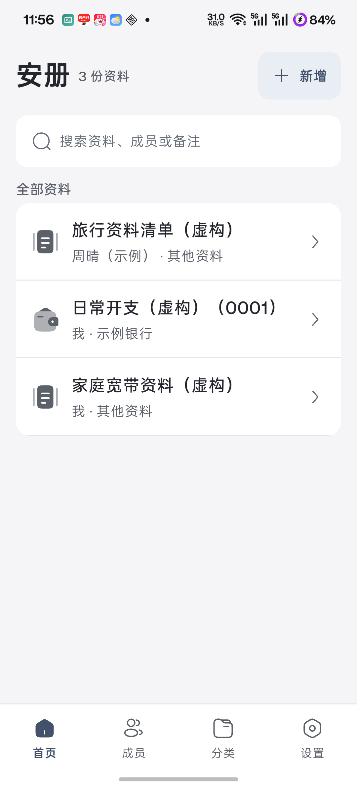
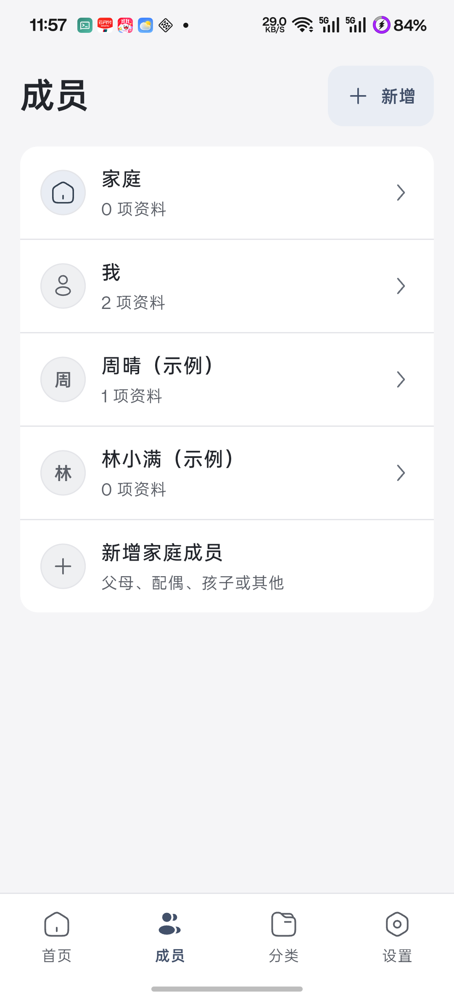
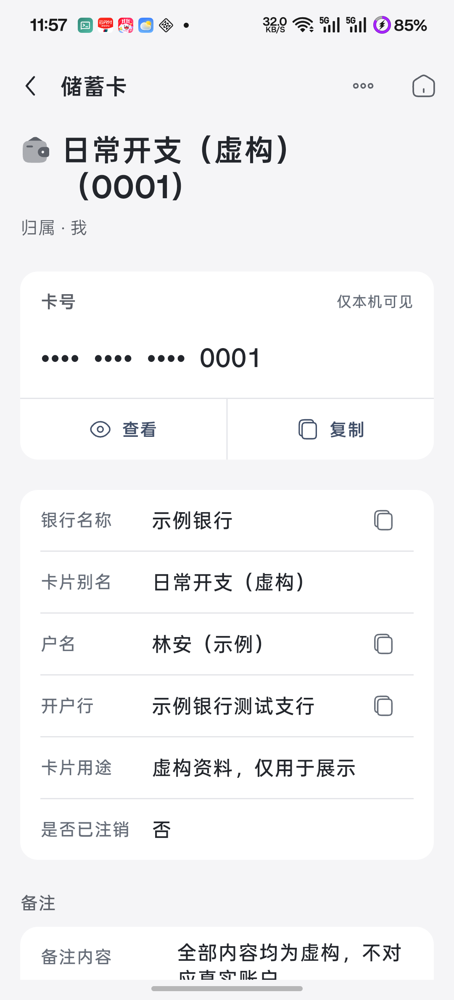

# 安册

安册是一款面向中文用户、Android 优先、完全离线的家庭资料册，用于在一台设备上整理自己和家人的身份证件、银行卡、保险、车辆、房产、教育证明和相关附件。

项目当前处于开发验证与工程收口阶段，尚未完成正式安全准入，禁止录入真实敏感资料。

核心价值依次是快速找到资料、安全查看与复制、可靠备份恢复、重要日期状态。到期状态只在应用内展示，当前不发送系统通知。

## 产品与开源方向

代表性体验是「按家人整理资料 → 快速查找 → 安全查看与复制 → 导出加密备份」。成员归属不代表多人协作；安册不做密码管理器，也不提供账号或云同步。

项目以个人产品作品的方式准备开源，展示离线资料整理、敏感信息交互和可靠恢复的设计与工程取舍。公开准备、许可证与验证状态见 [ROADMAP.md](ROADMAP.md) 。准备开源不代表已经公开或完成安全审计。

GitHub 仓库为 [setlater/anch](https://github.com/setlater/anch) ，普通问题通过 [Issues](https://github.com/setlater/anch/issues) 反馈，安全问题通过 [私密报告入口](SECURITY.md) 处理。

当前聚焦 Android 中文场景，保留已有核心能力并修复问题，暂不扩展 OCR、局域网传送、iOS、系统通知或商业激活。项目按作者精力维护，不承诺请求响应时限或全设备覆盖。

## 界面预览

以下为 Android 真机运行截图，成员与资料均为虚构。按成员整理、搜索与敏感字段遮蔽组成日常查找流程。

| 首页资料 | 家庭成员 | 敏感资料详情 |
| --- | --- | --- |
|  |  |  |

搜索、备份画面及素材来源见 [运行截图](docs/showcase/README.md) 。验证范围与剩余事项见 [ROADMAP.md](ROADMAP.md) 。

## 使用方式

1. 选择资料类型，再选择「我」「全家共用」或其他家庭成员，填写字段并补充附件；从成员页新增时直接使用该成员。
2. 通过首页、成员、分类或搜索查找；敏感字段默认遮蔽，查看和复制均由用户主动操作。
3. 不再日常使用的资料可以归档，误删资料可从最近删除恢复；最近删除没有自动清理期限。
4. 在「我的 → 数据与备份」直接导出加密备份或从备份恢复；备份密码需另行保管，恢复会整包覆盖，执行前先查看范围并确认。

收货地址支持点击后读取一次剪贴板、在本机解析并回填四个可编辑字段，保存前须核对。保险支持「续保一份」，保存新资料后再明确处理旧资料。应用锁可选择独立 PIN 与 Android 强生物识别。

## 产品原则

- 数据只保存在本机，不做账号和云同步。
- Release 构建不申请网络权限。
- 列表只展示低敏摘要，高敏字段默认遮蔽。
- 数据库、附件和手动备份使用独立的加密边界。
- 不保存支付密码、登录密码、验证码、CVV、私钥和助记词。

## 当前状态

主要产品流程已经具备。默认 `dev` 开发运行使用内存数据库；`securityValidation` 与 `formal` 使用加密文件数据库，Release 无论是否传入编译参数都强制进入正式安全模式。正式模式已可构建运行，但正式签名 Release 真机安全走查尚未完成，仍禁止录入真实敏感资料。Android 默认备份使用可跨本机密钥恢复的流式 V3，历史 V1／V2 保留导入兼容；旧格式附件无法用当前密钥解密时，会在覆盖前拒绝恢复。恢复通过 staging、原子切换与持久化恢复日志保护附件目录和数据库事务之间的中断。忘记 PIN 可用此前已启用的强生物识别验证后重设；否则只能确认物理清空本机资料，由应用根节点重建资料空间后重新开始或恢复备份。

真实进度、阻塞和验证结果以 [ROADMAP.md](ROADMAP.md) 为准。

发布前复核发现的屏幕保护异常处理缺口已修复：平台尚未确认保护时隐藏敏感内容，失败时阻断并允许重试，启动失败时不读取本机资料。自动化及新正式候选的受影响真机路径复核已通过，完整准入状态见路线图；当前仍不作面向真实敏感资料的正式发行。

首发候选安装包要求 ARM64、Android 8.0／API 26 及以上。当前真机验证范围如下，安装条件不代表全设备兼容承诺：

| 设备与系统 | 实际验证范围 |
| --- | --- |
| 一加 3T／Android 8.0 | 正式 Release 覆盖升级、附件跨重启读取、PIN 与受保护弹窗、V3 导出；另在独立贡献者安装中完成恢复与读回。 |
| 一加 12（PJD110）／Android 16 | 内部 Debug／Profile 及加密贡献者包的核心体验、展示与性能检查，尚不作为该机正式 Release 验收结论。 |

首发不要求增加设备。其他厂商、平板及完整分屏／字号矩阵作为后续兼容性工作，未验证范围如实保留；实际强生物识别成功仍未验证，正式安全准入尚未完成。

各主题只维护一份说明，当前进度集中在路线图：

| 内容 | 阅读入口 |
| --- | --- |
| 模块边界、数据流与设计取舍 | [架构](docs/architecture.md) |
| 密钥、应用锁、敏感状态与权限 | [安全](docs/security.md) |
| V3 格式、历史兼容与原子恢复 | [备份格式](docs/backup-format.md) |
| 测试分层、构建与内部签名 | [测试策略](docs/testing.md) |
| 虚构资料与手工操作步骤 | [手工验证](docs/manual-validation.md) |
| 主题、组件与自适应约束 | [视觉规范](docs/ui-visual-design.md) |
| 地址解析、候选评分与静态数据 | [地址解析](docs/shipping-address-parsing.md) |
| 第三方图标、静态数据与原生依赖的来源边界 | [第三方材料](docs/third-party-materials.md) |

## 开发环境

项目通过 FVM 固定 Flutter 版本：

```bash
fvm flutter pub get
fvm flutter analyze
fvm flutter test
```

Android 调试运行：

```bash
env ORG_GRADLE_PROJECT_anchContributor=true fvm flutter run -d <deviceId>
```

当前安全验证模式：

```bash
fvm flutter run -d <deviceId> \
  --dart-define=ANCH_SECURITY_MODE=securityValidation
```

该模式仅用于假数据验证，不代表正式发布模式。

贡献者入口使用独立包名和本机开发签名，默认运行使用内存数据库，退出进程后资料不保留；不能用于 Release。上面的安全验证命令属于维护者内部流程，需要固定内部签名。环境要求、持久化虚构资料体验和反馈方式见 [贡献说明](CONTRIBUTING.md) 。

## 设计取舍

- 按成员与资料类型组织同一份资料，不引入家庭账号或权限系统。
- 模板服务于查找和复制，不发展为任意字段配置平台。
- 应用锁负责访问控制，本机数据加密始终独立；具体威胁边界见 [安全设计](docs/security.md) 。
- 备份负责把资料带离当前设备，恢复先验证再覆盖；详见 [备份格式](docs/backup-format.md) 。

安全问题的反馈边界见 [安全报告说明](SECURITY.md) 。

## 许可

项目原创代码与文档采用 [MIT 许可证](LICENSE) ，版权署名为 setlater。第三方图标、静态数据和依赖保留各自许可，来源与待核验边界见 [第三方材料说明](docs/third-party-materials.md) 。

## 目录

```text
lib/app/       应用依赖装配
lib/core/      数据库、仓储、服务、安全、备份和模板
lib/features/  页面与页面状态
lib/widgets/   跨页面资料卡片展示
android/       Android 平台实现
test/          默认自动化测试
benchmark/     手动性能与规模测试
docs/          长期设计文档
```
